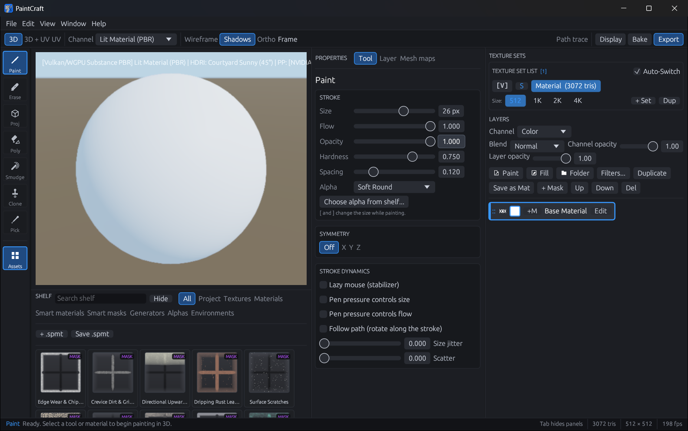
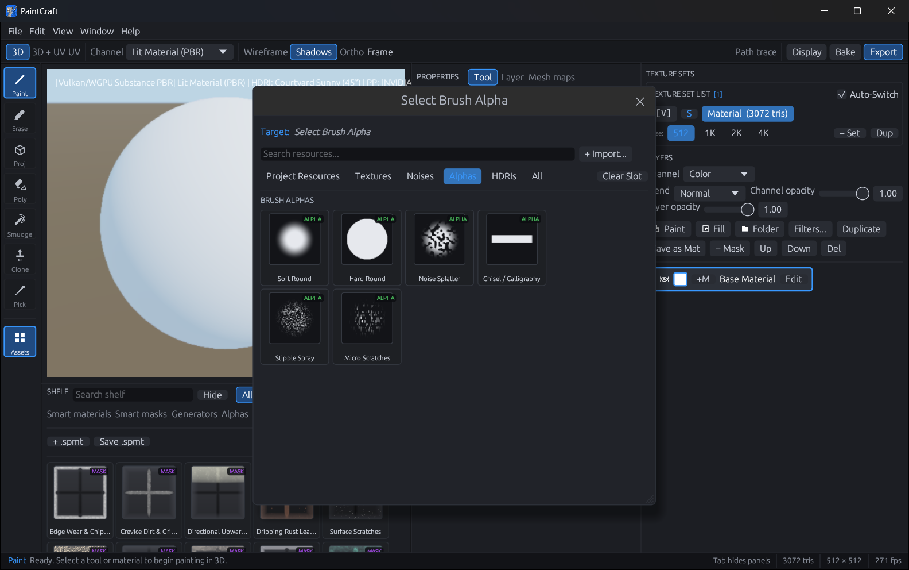

# PaintCraft

**3D texture painting for Windows, in a Substance Painter–style workspace.** Paint straight onto your models
across PBR channels, build materials from layers, masks and procedural generators, bake mesh maps, and export
textures for Unreal, Unity and Blender.

PaintCraft is built on [3D Paintcraft](https://github.com/Ras-Maciej/3DPaintCraft) by **Ras-Maciej**
(MIT OR Apache-2.0), whose painting engine it uses, and adds a redesigned workspace on top. See [NOTICE.md](NOTICE.md).



## Download

Get the latest version from the [Releases page](https://github.com/VibeCodedSoftware/PaintCraft/releases/latest):

| File | What it is |
|---|---|
| `PaintCraft-1.0.0-setup.exe` | **Recommended.** Installs for your Windows account (no administrator rights), adds Start menu and desktop shortcuts, and can be removed from *Settings › Apps*. |
| `PaintCraft-1.0.0-windows-x64.zip` | Portable. Unzip anywhere and run `paintcraft.exe` (keep the `assets` folder beside it). |

Windows 10 or 11, 64-bit, with a GPU that supports Vulkan or DirectX 12 (a software fallback is used
otherwise). The program isn't code-signed yet, so Windows SmartScreen may warn the first time: choose
**More info › Run anyway**.

## What's in it

- **Painting on the model:** projection painting in the 3D view, a 2D UV view, or both side by side;
  brushes with alphas, stencils, symmetry and pen pressure; paint, erase, smudge, clone and polygon fill.
- **A PBR layer stack:** base colour, roughness, metallic, normal, height, ambient occlusion and emission;
  paint and fill layers, folders, masks, blend modes and per-channel opacity.
- **The Shelf:** smart materials, smart masks, procedural generators (noise, grunge, scratches, edge wear,
  dust, leaks, bricks and more), brush alphas and HDRI environments, each with a live thumbnail.
- **Mesh map bakers:** curvature, ambient occlusion, world-space normals, position, thickness and IDs, which
  drive the smart masks and materials.
- **Viewport:** physically based shading, HDRI lighting, shadows and a path tracer for final renders.
- **Export presets** for Unreal Engine (packed ORM), Unity, Blender/glTF, or individual maps.
- **An MCP server** (`paintcraft.exe --mcp`) so AI agents can inspect, paint, bake and export.



## Build from source

Needs [Rust](https://rustup.rs/) (stable, MSVC toolchain on Windows).

```sh
cargo build --release   # target/release/paintcraft.exe; run it with the assets folder beside it
```

## License and credits

PaintCraft is licensed under **MIT OR Apache-2.0** ([LICENSE-MIT](LICENSE-MIT), [LICENSE-APACHE](LICENSE-APACHE)),
the same terms as 3D Paintcraft by Ras-Maciej, which it is built on. Substance Painter is a trademark of Adobe Inc.;
PaintCraft is an independent project and isn't affiliated with Adobe.
